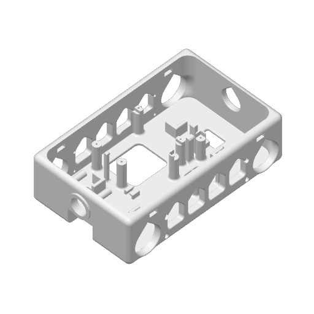
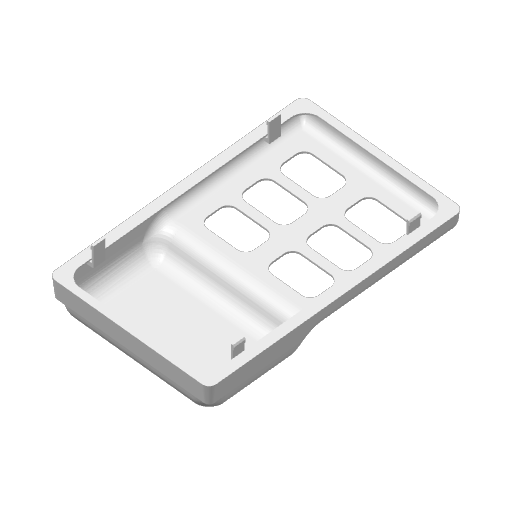
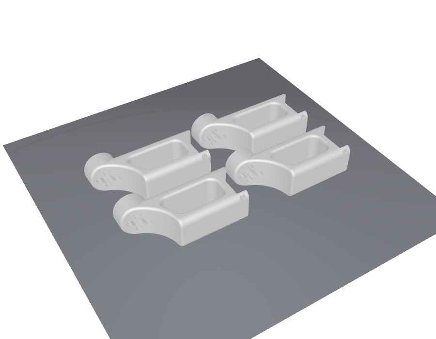

# Bill of materials (BOM) — KRS version 8-DoF quadruped

What you need to build {doc}`krs`. Kondo Kagaku parts are priced from Kondo Kagaku's
product pages and its direct-sales site (ROBOSPOT Web Shop) (as of October 2026, tax
included).

```{contents} On this page
:local:
:depth: 2
```

---

## Buying it as a set: KXR Advanced Set B Ver.2 (recommended)

Kondo Kagaku's **[KXR Advanced Set B Ver.2](https://kondo-robot.com/product/03159) (03159)**
contains all of this robot's Kondo Kagaku parts. **Add an Arduino and jumper wires to
this one set and you have everything.** It has 18 servos, more than the 8 needed, and
comes with a battery and a charger.

| Set contents | Qty |
|---|---|
| KRS-3302 ICS | 18 |
| RCB-4mini | 1 |
| Dual USB Adapter HS | 1 |
| ROBO Power Cell E type 6N-800mAh Ni-MH (battery) | 1 |
| Charger BX-32MH | 1 |
| Reinforced resin parts, cables, screws | 1 set |

Kondo Kagaku lists the price as "open"; at [Marutsu](https://www.marutsu.co.jp/pc/i/1558525/)
it is **¥84,480** (as of October 2026). That is more than the total for "Buying the parts
one by one" below (about ¥54,800), but you get 10 more servos plus the battery and
charger.

The kinds and numbers of cables in the set are not listed. If you run short of the
ZH connection cable 2 A type (120mm, 160mm) used for the wiring inside the body, buy more
from the table below. Whether the set includes the small-diameter horn B and the screws
(M2 low-head screws) is not listed either, so if you run short, buy items 9 and 10 in
the table below.

## Buying the parts one by one

| # | Item | Part no. | Unit price | Qty | Subtotal |
|---|---|---|---|---|---|
| 1 | [KRS-3302 ICS 6-pack](https://kondo-robot.com/product/03146) | 03147 | ¥21,780 | 1 | ¥21,780 |
| 2 | [KRS-3302 ICS (single)](https://kondo-robot.com/robospot/html/products/detail.php?product_id=1852) | 03146 | ¥4,180 | 2 | ¥8,360 |
| 3 | [RCB-4mini](https://kondo-robot.com/product/rcb4_mini) | 03120 | ¥10,780 | 1 | ¥10,780 |
| 4 | [Dual USB Adapter HS](https://kondo-robot.com/product/02116) | 02116 | ¥6,600 | 1 | ¥6,600 |
| 5 | [ZH connection cable 2 A type 120mm](https://kondo-robot.com/robospot/html/products/detail.php?product_id=1779) | 02330 | ¥440 | 4 | ¥1,760 |
| 6 | [ZH connection cable 2 A type 160mm](https://kondo-robot.com/robospot/html/products/detail.php?product_id=1780) | 02331 | ¥440 | 4 | ¥1,760 |
| 7 | [Cable with connectors 20cm 40P male–male](https://akizukidenshi.com/catalog/g/g115869/) (jumper wires) | Akizuki 115869 | ¥160 | 1 | ¥160 |
| 8 | [ZH connection cable 2 B type 100mm](https://kondo-robot.com/product/02219) (optional) | 02219 | ¥440 | 0–2 | — |
| 9 | [Small-diameter horn B (PCDφ12-M2-offset 0), pack of 12](https://kondo-robot.com/product/02157) | 02158 | ¥1,650 | 1 | ¥1,650 |
| 10 | [Screw Set A (for KXR)](https://kondo-robot.com/product/02328) | 02328 | ¥1,980 | 1 | ¥1,980 |

**Total about ¥54,800** (excluding the optional item 8, the Arduino and the power supply
(AC adapter or battery)). The servos are 55% of it.

- **8 servos.** Buying the 6-pack plus two singles is ¥3,300 cheaper than 8 singles
  (¥33,440). Each servo comes with ZH connection cable 2 (one A type and one B type, 300mm
  each) and one M3×6 screw.
- **ZH connection cable 2 A type** (3 wires, ZH on both ends) connects servo to servo and
  servo to RCB-4mini. Four each of 120mm and 160mm are used.
- **Jumper wires**: tear 4 off a bundle of 40 with male pins on both ends. They go from
  the servo connector of a ZH connection cable 2 B type to the Arduino: three for TX, RX
  and GND, and one for VIN.
- **ZH connection cable 2 B type** is a cable with ZH on one end and, on the other, a
  servo connector (female) that fits a 2.54 mm pitch pin header. Two are used: one for the
  RCB-4mini's COM port and one to take power from an SIO port to the Arduino. **The 300mm
  ones that come with the servos are enough, so you do not need to buy them.** If the
  extra length inside the body bothers you, buy two 100mm ones.
- The **Dual USB Adapter HS** is only used for setting the servo IDs. It is not mounted on
  the finished robot.
- The **small-diameter horn B** does not come with the servos. One per servo, 8 in all
  (one pack of 12).
- **Screw Set A** contains the M2-4, M2-6 and M2-8 low-head screws used on this robot
  (M2-4 ×16, M2-6 ×24, M2-8 ×8; where they go is in {ref}`krs-screws`).
  To buy them separately: [M2-4 low-head screw](https://kondo-robot.com/product/02086)
  (02086, ¥550), [M2-6 low-head screw, pack of 100](https://kondo-robot.com/product/02325)
  (02325, ¥440), [M2-8 low-head screw, pack of 100](https://kondo-robot.com/product/02326)
  (02326, ¥440).
  On the knee's bottom case side, the case screws already fitted to the servo are taken
  out and put back, so there is nothing extra to buy.

You also need an **Arduino UNO R4 WiFi**.

## Power

Power comes from either the AC adapter or the battery. Either one supplies the servos,
the RCB-4mini and the Arduino on its own (for how to connect it, see "Power" in
{doc}`krs`).

### AC adapter

For trying things on the desk. **It is not included in the Advanced Set B**, so buy it
separately.

| Item | Part no. | Price | Notes |
|---|---|---|---|
| [AC adapter (5.9V2A)](https://kondo-robot.com/product/04052) | 04052 | ¥3,850 | DC 5.9 V, 2 A. Comes with an LV conversion DC jack (VH 2-pin), so it plugs into the same place as the battery |

5.9 V is slightly below the Arduino's VIN range (6–24 V), so when using the AC adapter,
also keep the USB cable plugged into the Arduino.

### Battery (when buying the parts one by one)

To walk without a cable, use one Kondo Kagaku Ni-MH battery. The Advanced Set B includes
the same battery and charger, so if you bought the set you do not need these.

| Item | Part no. | Price | Notes |
|---|---|---|---|
| [ROBO Power Cell E type 6N-800mAh](https://kondo-robot.com/product/02335) | 02335 | ¥3,850 | Ni-MH 6 cells, 7.2 V nominal, 800 mAh, 78 g. VH 2-pin connector |
| [BX-32MH Ni-MH charger](https://kondo-robot.com/product/51207) | 51207 | ¥3,740 | For 6-cell Ni-MH only. Needs a separate USB AC adapter of 5 V, 1–2 A (2 A recommended). Cannot charge from a PC's USB port |

The E type cannot be charged with a LiFe charger (such as the BX-31LF).

## 3D-printed parts

The KRS version's body and legs are shaped to fit the KRS-3302 and differ from the
Feetech version's STLs. Download the STLs below (in millimetres; exported from the same
CAD data as the 3D viewer in {ref}`krs-assembly`). For rough print settings, see the
Feetech version's {doc}`bom`.

| Part | File | Size [mm] | Qty | Volume |
|---|---|---|---|---|
| Body | `body_krs.stl` | **176.0 × 110.0 × 50.0** | 1 | 179.2 cm³ |
| Lid | `lid_krs.stl` | 174.0 × 110.0 × 37.0 | 1 | 32.3 cm³ |
| Leg bracket | `bracket_outline_krs.stl` | 127.9 × 52.2 × 12.0 | 4 | 19.1 cm³ |
| Leg link | `leg_link1_krs.stl` | 84.0 × 43.0 × 26.0 | 4 | 33.6 cm³ |

::::{grid} 2 4 4 4
:gutter: 2

:::{grid-item}

```{button-link} ../../assembly/quadruped_krs/stl/body_krs.stl
:color: primary
:expand:
body_krs.stl (×1)
```

:::
:::{grid-item}

```{button-link} ../../assembly/quadruped_krs/stl/lid_krs.stl
:color: primary
:expand:
lid_krs.stl (×1)
```

:::
:::{grid-item}

```{button-link} ../../assembly/quadruped_krs/stl/bracket_outline_krs.stl
:color: primary
:expand:
bracket_outline_krs.stl (×4)
```

:::
:::{grid-item}

```{button-link} ../../assembly/quadruped_krs/stl/leg_link1_krs.stl
:color: primary
:expand:
leg_link1_krs.stl (×4)
```

:::
::::

### Sliced projects (for Bambu Studio)

Bambu Studio project files with the settings and layout included (all for a 0.4 nozzle
and the Textured PEI plate). The body and lid are the version 2 shapes sliced for PLA
Matte (white); the two leg plates are sliced for the A1 and PLA. To print on a different
printer or filament, open the project and change the printer and filament.

| Project | Contents | Printer | Filament | Layer | Supports |
|---|---|---|---|---|---|
| `body_krs.3mf` | Body ×1 | Bambu Lab H2D | PLA Matte | 0.2mm | Tree (auto) |
| `lid_krs.3mf` | Lid ×1 (placed upside down) | Bambu Lab X1 Carbon | PLA Matte | 0.2mm | Tree (auto) |
| `leg_links_krs.3mf` | Leg link ×4 | Bambu Lab A1 | PLA | 0.2mm | Tree (auto) |
| `leg_brackets_krs.3mf` | Leg bracket ×4 | Bambu Lab A1 | PLA | 0.2mm | Tree (auto) |

The slicer estimates are 4 h 01 min and 125.3 g for the body, and 3 h 46 min and 68.6 g
for the lid (both including supports).
The body is 176 × 110 mm, so it also fits on the plate of an A1 mini (180 mm square).

**Open in Bambu Studio** launches Bambu Studio and opens the project directly
(Bambu Studio must be installed). Because the file does not come from MakerWorld,
Bambu Studio asks "This file is not from a trusted site"; click **Yes** to open it.

::::{grid} 1 2 2 2
:gutter: 2

:::{grid-item}

```{button-link} ../../assembly/quadruped_krs/stl/body_krs.3mf
:color: secondary
:expand:
body_krs.3mf (body)
```

<a class="sd-sphinx-override sd-btn sd-text-wrap sd-btn-primary sd-w-100 bambu-open" data-file="../../assembly/quadruped_krs/stl/body_krs.3mf" hidden>Open in Bambu Studio</a>


:::
:::{grid-item}

```{button-link} ../../assembly/quadruped_krs/stl/lid_krs.3mf
:color: secondary
:expand:
lid_krs.3mf (lid)
```

<a class="sd-sphinx-override sd-btn sd-text-wrap sd-btn-primary sd-w-100 bambu-open" data-file="../../assembly/quadruped_krs/stl/lid_krs.3mf" hidden>Open in Bambu Studio</a>


:::
:::{grid-item}

```{button-link} ../../assembly/quadruped_krs/stl/leg_links_krs.3mf
:color: secondary
:expand:
leg_links_krs.3mf (leg link ×4)
```

<a class="sd-sphinx-override sd-btn sd-text-wrap sd-btn-primary sd-w-100 bambu-open" data-file="../../assembly/quadruped_krs/stl/leg_links_krs.3mf" hidden>Open in Bambu Studio</a>


:::
:::{grid-item}

```{button-link} ../../assembly/quadruped_krs/stl/leg_brackets_krs.3mf
:color: secondary
:expand:
leg_brackets_krs.3mf (leg bracket ×4)
```

<a class="sd-sphinx-override sd-btn sd-text-wrap sd-btn-primary sd-w-100 bambu-open" data-file="../../assembly/quadruped_krs/stl/leg_brackets_krs.3mf" hidden>Open in Bambu Studio</a>


:::
::::

**The left and right legs use the same parts.** Print four of each of the leg link and
the leg bracket; there are no separate left and right versions (they are assembled
facing opposite ways on the left and right).

The leg brackets show opposite faces on the outside on the left and right, so in
`leg_brackets_krs.3mf` **two of the four are placed upside down.** The face that gets
support marks is flipped on two of them, so on the finished robot the marked faces end
up on the same side (inside or outside) on both the left and right legs.

## Sources

- KXR Advanced Set B Ver.2 (set contents): <https://kondo-robot.com/product/03159>,
  price at Marutsu <https://www.marutsu.co.jp/pc/i/1558525/>
- KRS-3302 ICS (single and 6-pack, accessories): <https://kondo-robot.com/product/03146>,
  prices on the direct-sales site <https://kondo-robot.com/robospot/html/products/detail.php?product_id=1852> and
  <https://kondo-robot.com/robospot/html/products/list.php?category_id=0&pageno=15>
- RCB-4mini (part number): <https://kondo-robot.com/product/rcb4_mini>
- Small-diameter horn B (part number 02158 and price of the pack of 12, compatible servos): <https://kondo-robot.com/product/02157>.
  The KRS-3302 accessories include no horn: <https://kondo-robot.com/product/03146>
- Contents and price of Screw Set A (for KXR): <https://kondo-robot.com/product/02328>,
  M2-4 low-head screw <https://kondo-robot.com/product/02086>, M2-6 low-head screw <https://kondo-robot.com/product/02325>,
  M2-8 low-head screw <https://kondo-robot.com/product/02326> (prices on each page, as of October 2026)
- Dual USB Adapter HS: <https://kondo-robot.com/product/02116>
- ZH connection cable 2 A type (part numbers by length): <https://kondo-robot.com/product/02329>
- ZH connection cable 2 B type (part numbers by length, fits a 2.54 pitch pin header): <https://kondo-robot.com/product/02219>
- ROBO Power Cell E type 6N-800mAh: <https://kondo-robot.com/product/02335>
- AC adapter (5.9V2A, LV conversion DC jack included): <https://kondo-robot.com/product/04052>,
  LV conversion DC jack (VH 2-pin): <https://kondo-robot.com/product/02186>,
  no AC adapter included in the set: <https://kondo-robot.com/product/03159>
- BX-32MH: <https://kondo-robot.com/product/51207>
- Cable with connectors 20cm 40P male–male: <https://akizukidenshi.com/catalog/g/g115869/>
- KRS-3302 supply voltage (6–7.4 V): <https://kondo-robot.com/product/03146>,
  KRS series instruction manual V2.1 <https://kondo-robot.com/w/wp-content/uploads/KRS-series_manual_Download-V2_1.pdf>
