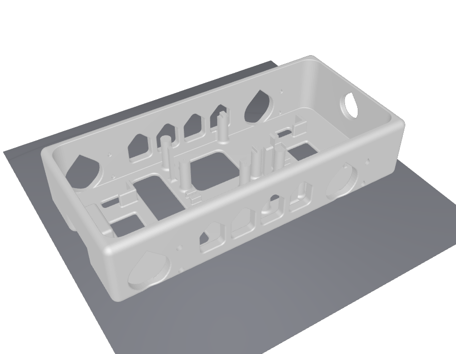
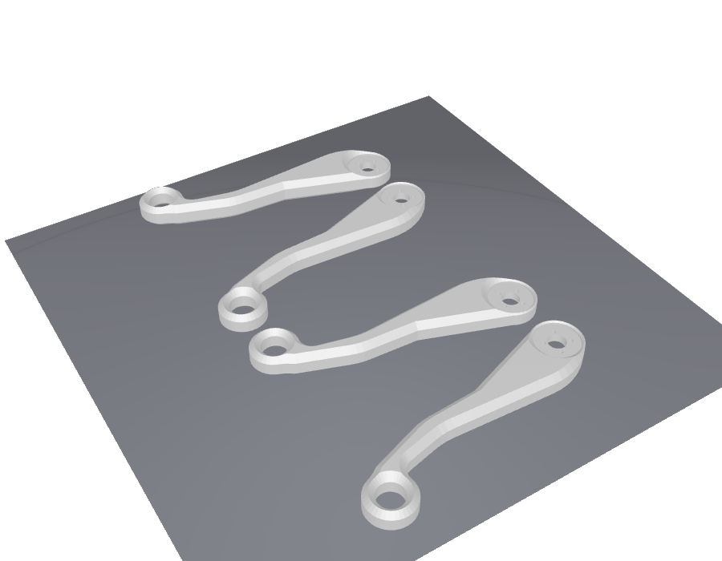

# 部品表（BOM）— KRS 版 8 自由度四脚ロボット

{doc}`krs` を作るのに要るもの。近藤科学の部品は、近藤科学の商品ページと、
近藤科学の直販サイト（ロボスポット Web Shop）の価格です（2026 年 10 月時点、税込）。

```{contents} このページの内容
:local:
:depth: 2
```

---

## まとめて買うなら：KXR アドバンスセット B Ver.2（おすすめ）

近藤科学の **[KXR アドバンスセット B Ver.2](https://kondo-robot.com/product/03159)（03159）** に、
このロボットの近藤科学の部品がまとめて入っている。**これ 1 個に Arduino と
ジャンパワイヤを足せばそろう。** サーボは 8 個より多い 18 個入っていて、バッテリーと
充電器も付いてくる。

| セットの中身 | 数 |
|---|---|
| KRS-3302 ICS | 18 |
| RCB-4mini | 1 |
| Dual USB アダプター HS | 1 |
| ROBO パワーセル E タイプ 6N-800mAh Ni-MH（バッテリー） | 1 |
| 充電器 BX-32MH | 1 |
| 強化樹脂パーツ、ケーブル、ビス類 | 一式 |

価格は近藤科学では「オープン」で、[マルツ](https://www.marutsu.co.jp/pc/i/1558525/)では
**¥84,480**（2026 年 10 月時点）。下の「1 つずつ買う」の合計（約 ¥54,800）より高いが、
サーボが 10 個多く、バッテリーと充電器も入っている。

セットに入っているケーブルの種類と本数は書かれていない。胴体の中の配線に使う
ZH接続ケーブル2 Aタイプ（120mm・160mm）が足りなければ、下の表から買い足す。
小径ホーン B とネジ（M2 低頭ビス）がセットに入っているかも書かれていないので、
足りなければ下の表の 9・10 を買う。

## 1 つずつ買う

| # | 品目 | 品番 | 単価 | 数 | 小計 |
|---|---|---|---|---|---|
| 1 | [KRS-3302 ICS 6 個セット](https://kondo-robot.com/product/03146) | 03147 | ¥21,780 | 1 | ¥21,780 |
| 2 | [KRS-3302 ICS（1 個）](https://kondo-robot.com/robospot/html/products/detail.php?product_id=1852) | 03146 | ¥4,180 | 2 | ¥8,360 |
| 3 | [RCB-4mini](https://kondo-robot.com/product/rcb4_mini) | 03120 | ¥10,780 | 1 | ¥10,780 |
| 4 | [Dual USB アダプター HS](https://kondo-robot.com/product/02116) | 02116 | ¥6,600 | 1 | ¥6,600 |
| 5 | [ZH接続ケーブル2 Aタイプ 120mm](https://kondo-robot.com/robospot/html/products/detail.php?product_id=1779) | 02330 | ¥440 | 4 | ¥1,760 |
| 6 | [ZH接続ケーブル2 Aタイプ 160mm](https://kondo-robot.com/robospot/html/products/detail.php?product_id=1780) | 02331 | ¥440 | 4 | ¥1,760 |
| 7 | [コネクター付ケーブル 20cm 40P オスオス](https://akizukidenshi.com/catalog/g/g115869/)（ジャンパワイヤ） | 秋月 115869 | ¥160 | 1 | ¥160 |
| 8 | [ZH接続ケーブル2 Bタイプ 100mm](https://kondo-robot.com/product/02219)（任意） | 02219 | ¥440 | 0〜2 | — |
| 9 | [小径ホーンB（PCDφ12-M2-オフセット0）12 個入り](https://kondo-robot.com/product/02157) | 02158 | ¥1,650 | 1 | ¥1,650 |
| 10 | [ビスセットA（KXR用）](https://kondo-robot.com/product/02328) | 02328 | ¥1,980 | 1 | ¥1,980 |

**合計 約 ¥54,800**（任意の 8 と、Arduino、バッテリーを除く）。サーボが 55% を占める。

- **サーボは 8 個。** 6 個セットと 1 個を 2 つ買うと、1 個ずつ 8 個（¥33,440）より
  ¥3,300 安い。サーボ 1 個ごとに ZH接続ケーブル2（A タイプと B タイプ、各 300mm）と
  M3×6 のネジが 1 本ずつ付いてくる。
- **ZH接続ケーブル2 Aタイプ**（両端が ZH の 3 線）は、サーボどうしと、サーボと
  RCB-4mini をつなぐ。120mm と 160mm を 4 本ずつ使う。
- **ジャンパワイヤ** は、両端がオスピンの 40 本の束を裂いて 4 本使う。ZH接続ケーブル2
  Bタイプのサーボコネクタから Arduino へ、TX・RX・GND の 3 本と、VIN の 1 本。
- **ZH接続ケーブル2 Bタイプ** は片側が ZH、もう片側が 2.54 mm ピッチのピンヘッダに
  挿せるサーボコネクタ（メス）のケーブル。RCB-4mini の COM ポート用と、SIO ポートから
  Arduino へ電源を取る用に 2 本使う。**サーボに付いてくる 300mm で足りるので、
  買わなくてよい。** 胴体の中で長さが余るのが気になるなら、100mm を 2 本買う。
- **Dual USB アダプター HS** はサーボに ID を振るときだけ使う。組み上がったロボットには
  載せない。
- **小径ホーン B** はサーボに付いてこない。1 個のサーボに 1 個、8 個使う（12 個入りを 1 つ）。
- **ビスセット A** に、このロボットで使う M2-4・M2-6・M2-8 の低頭ビスが入っている
  （M2-4 ×16、M2-6 ×24、M2-8 ×8。使う場所は {ref}`krs-screws`）。
  単品で買うなら [M2-4 低頭ビス](https://kondo-robot.com/product/02086)（02086、¥550）、
  [M2-6 低頭ビス 100 本入り](https://kondo-robot.com/product/02325)（02325、¥440）、
  [M2-8 低頭ビス 100 本入り](https://kondo-robot.com/product/02326)（02326、¥440）。
  膝のボトムケース側は、サーボに最初から締めてあるケースビスをいったん抜いて止め直すので、
  買い足さなくてよい。

このほかに **Arduino UNO R4 WiFi** が要る。

## バッテリー（1 つずつ買う場合）

ケーブルなしで歩かせるなら、近藤科学の Ni-MH バッテリーを 1 本使う。サーボ・RCB-4mini・
Arduino をこれ 1 本でまかなう（つなぎ方は {doc}`krs` の「電源」）。アドバンスセット B には
同じバッテリーと充電器が入っているので、セットを買ったなら要らない。

| 品目 | 品番 | 価格 | メモ |
|---|---|---|---|
| [ROBO パワーセル E タイプ 6N-800mAh](https://kondo-robot.com/product/02335) | 02335 | ¥3,850 | Ni-MH 6 セル、公称 7.2 V、800 mAh、78 g。コネクターは VH 2 ピン |
| [BX-32MH ニッケル水素専用充電器](https://kondo-robot.com/product/51207) | 51207 | ¥3,740 | 6 セルの Ni-MH 専用。5 V・1〜2 A（2 A 推奨）の USB AC アダプターが別に要る。PC の USB からは充電できない |

E タイプは LiFe 用の充電器（BX-31LF など）では充電できない。

## 3D プリント部品

KRS 版の胴体と脚は、KRS-3302 の形に合わせたもので、Feetech 版の STL とは形が違う。
STL は下からダウンロードできる（単位はミリメートル。{ref}`krs-assembly` の 3D ビューアと
同じ CAD データから書き出したもの）。印刷の設定の目安は Feetech 版の {doc}`bom` を参照。

| 部品 | ファイル | 外形 [mm] | 個数 | 実体積 |
|---|---|---|---|---|
| 胴体 | `body_krs.stl` | **230.0 × 110.0 × 50.0** | 1 | 227.6 cm³ |
| 脚ブラケット | `bracket_outline_krs.stl` | 127.9 × 52.2 × 12.0 | 4 | 19.1 cm³ |
| 脚リンク | `leg_link1_krs.stl` | 84.0 × 43.0 × 26.0 | 4 | 33.6 cm³ |

::::{grid} 3
:gutter: 2

:::{grid-item}

```{button-link} ../assembly/quadruped_krs/stl/body_krs.stl
:color: primary
:expand:
body_krs.stl（×1）
```

:::
:::{grid-item}

```{button-link} ../assembly/quadruped_krs/stl/bracket_outline_krs.stl
:color: primary
:expand:
bracket_outline_krs.stl（×4）
```

:::
:::{grid-item}

```{button-link} ../assembly/quadruped_krs/stl/leg_link1_krs.stl
:color: primary
:expand:
leg_link1_krs.stl（×4）
```

:::
::::

### スライス済みプロジェクト（Bambu Studio 用）

設定・配置が入った Bambu Studio のプロジェクトファイルです（どれも 0.4 ノズル・
Textured PEI プレート）。胴体は実機を刷ったときのもの、脚の 2 枚は A1 と PLA で
スライスしたものです。別の機種やフィラメントで刷る場合は、開いてからプリンターと
フィラメントを変えてください。

| プロジェクト | 中身 | プリンター | フィラメント | 積層 | サポート |
|---|---|---|---|---|---|
| `body_krs.3mf` | 胴体 ×1 | Bambu Lab P1S | ABS | 0.28mm | なし |
| `leg_links_krs.3mf` | 脚リンク ×4 | Bambu Lab A1 | PLA | 0.2mm | ツリー（自動） |
| `leg_brackets_krs.3mf` | 脚ブラケット ×4 | Bambu Lab A1 | PLA | 0.2mm | ツリー（自動） |

「Bambu Studio で開く」を押すと、Bambu Studio が起動してプロジェクトを
そのまま開きます（Bambu Studio のインストールが必要）。MakerWorld 以外から
開くので「This file is not from a trusted site」と確認が出ます。
**Yes** を押せば開きます。

::::{grid} 1 3 3 3
:gutter: 2

:::{grid-item}

```{button-link} ../assembly/quadruped_krs/stl/body_krs.3mf
:color: secondary
:expand:
body_krs.3mf（胴体）
```

<a class="sd-sphinx-override sd-btn sd-text-wrap sd-btn-primary sd-w-100 bambu-open" data-file="../assembly/quadruped_krs/stl/body_krs.3mf" hidden>Bambu Studio で開く</a>


:::
:::{grid-item}

```{button-link} ../assembly/quadruped_krs/stl/leg_links_krs.3mf
:color: secondary
:expand:
leg_links_krs.3mf（脚リンク ×4）
```

<a class="sd-sphinx-override sd-btn sd-text-wrap sd-btn-primary sd-w-100 bambu-open" data-file="../assembly/quadruped_krs/stl/leg_links_krs.3mf" hidden>Bambu Studio で開く</a>


:::
:::{grid-item}

```{button-link} ../assembly/quadruped_krs/stl/leg_brackets_krs.3mf
:color: secondary
:expand:
leg_brackets_krs.3mf（脚ブラケット ×4）
```

<a class="sd-sphinx-override sd-btn sd-text-wrap sd-btn-primary sd-w-100 bambu-open" data-file="../assembly/quadruped_krs/stl/leg_brackets_krs.3mf" hidden>Bambu Studio で開く</a>


:::
::::

**左右の脚は同じ部品。** 脚リンクも脚ブラケットも 1 つの形を 4 個刷ればよく、
左右の作り分けは要らない（左右で向きを変えて組む）。

脚ブラケットは左右で外側に出る面が逆になるので、`leg_brackets_krs.3mf` では
**4 個のうち 2 個を裏返して置いてある。** サポートの跡が付く面が 2 個ずつ逆になるので、
組み上げたとき左右の脚で跡の付いた面が同じ側（内側か外側）にそろう。

## 出典

- KXR アドバンスセット B Ver.2（セットの中身）: <https://kondo-robot.com/product/03159>、
  価格はマルツ <https://www.marutsu.co.jp/pc/i/1558525/>
- KRS-3302 ICS（単品・6 個セット、付属品）: <https://kondo-robot.com/product/03146>、
  価格は直販サイト <https://kondo-robot.com/robospot/html/products/detail.php?product_id=1852> と
  <https://kondo-robot.com/robospot/html/products/list.php?category_id=0&pageno=15>
- RCB-4mini（品番）: <https://kondo-robot.com/product/rcb4_mini>
- 小径ホーンB（12 個入りの品番 02158・価格、対応サーボ）: <https://kondo-robot.com/product/02157>。
  KRS-3302 の付属品にホーンが無いこと: <https://kondo-robot.com/product/03146>
- ビスセットA（KXR用）の中身と価格: <https://kondo-robot.com/product/02328>、
  M2-4 低頭ビス <https://kondo-robot.com/product/02086>、M2-6 低頭ビス <https://kondo-robot.com/product/02325>、
  M2-8 低頭ビス <https://kondo-robot.com/product/02326>（価格は各ページ、2026 年 10 月時点）
- Dual USB アダプター HS: <https://kondo-robot.com/product/02116>
- ZH接続ケーブル2 Aタイプ（長さ別の品番）: <https://kondo-robot.com/product/02329>
- ZH接続ケーブル2 Bタイプ（長さ別の品番、2.54 ピッチのピンヘッダに挿せること）: <https://kondo-robot.com/product/02219>
- ROBO パワーセル E タイプ 6N-800mAh: <https://kondo-robot.com/product/02335>
- BX-32MH: <https://kondo-robot.com/product/51207>
- コネクター付ケーブル 20cm 40P オスオス: <https://akizukidenshi.com/catalog/g/g115869/>
- KRS-3302 の電源電圧（6〜7.4 V）: <https://kondo-robot.com/product/03146>、
  KRS シリーズ取扱説明書 V2.1 <https://kondo-robot.com/w/wp-content/uploads/KRS-series_manual_Download-V2_1.pdf>
